<p align="center">
  <a href="https://github.com/Devguru-codes">
    
  </a>
</p>

<p align="center">
  <a href="https://my-portfolio-website-silk-one.vercel.app/"></a>
  <a href="https://linkedin.com/in/devguru-tiwari"></a>
  <a href="mailto:devguruatwork@gmail.com"></a>
  <a href="https://www.kaggle.com/devgurucodes"></a>
  
</p>

## 👨‍💻 About me

I'm a B.Tech student at **IIIT Nagpur** (class of '27) working across the whole data stack: from SQL, EDA and dashboards that answer business questions, to models that predict, to the production pipelines that ship them.

<table>
  <tr>
    <th width="33%">📊 Data analytics</th>
    <th width="33%">🔬 Data science</th>
    <th width="33%">⚙️ ML engineering</th>
  </tr>
  <tr>
    <td valign="top">
      <i>Turning raw data into answers</i>
      <ul>
        <li>SQL and Pandas wrangling</li>
        <li>EDA and statistical testing</li>
        <li>Power BI dashboards and KPIs</li>
        <li>Data storytelling and reports</li>
      </ul>
    </td>
    <td valign="top">
      <i>Models that predict and explain</i>
      <ul>
        <li>Feature engineering</li>
        <li>Imbalanced classification</li>
        <li>Time-series forecasting</li>
        <li>SHAP explainability</li>
        <li>Big data with PySpark</li>
      </ul>
    </td>
    <td valign="top">
      <i>Models that ship</i>
      <ul>
        <li>FastAPI model services</li>
        <li>Docker and GitHub Actions CI/CD</li>
        <li>LLM agents and RAG</li>
        <li>3D medical imaging</li>
      </ul>
    </td>
  </tr>
</table>

```python
class Devguru:
    focus      = ["data science", "analytics", "MLOps", "model reproducibility"]
    building   = ["dashboards that drive decisions", "production ML systems", "multi-agent LLM apps"]
    learning   = ["experiment tracking", "container orchestration", "infrastructure automation"]
    open_to    = ["data science & analytics projects", "MLOps-driven projects", "scalable ML systems"]
    want_help  = ["advanced MLOps", "CI/CD for ML", "monitoring models in production"]
    ask_me     = ["EDA", "feature engineering", "model evaluation", "Dockerizing ML", "GitHub Actions"]
    fun_fact   = "When I am tired, I go to sleep."
```

## 🚀 Featured projects

#### 📊 Data science & analytics

<table>
  <tr>
    <td width="50%" valign="top">
      <a href="https://github.com/Devguru-codes/Power-BI-Project-Renewable-Energy-Dashboards"><b>🌍 Renewable Energy Dashboards</b></a><br/>
      Power BI analysis of global renewable energy since 1965, built around 10 business questions, with KPI pages and solar, wind and hydro deep-dives.<br/>
      <code>Power BI</code> <code>SQL</code> <code>Pandas</code>
    </td>
    <td width="50%" valign="top">
      <a href="https://github.com/Devguru-codes/UIDAI-DATA-HACKATHON-2026"><b>🗺️ Aadhaar Pulse</b></a><br/>
      UIDAI Hackathon 2026: fuses demographic, biometric and enrolment data to track migration and flag enrolment fraud with rolling z-scores and forecasting.<br/>
      <code>Pandas</code> <code>Prophet</code> <code>GeoPandas</code>
    </td>
  </tr>
  <tr>
    <td width="50%" valign="top">
      <a href="https://github.com/Devguru-codes/Credit-Card-Fraud-Detection"><b>💳 Credit Card Fraud Detection</b></a><br/>
      Fraud pipeline covering temporal feature engineering, severe class imbalance and meta-heuristic feature selection, comparing classical and quantum ML.<br/>
      <code>scikit-learn</code> <code>Imbalanced data</code> <code>QML</code>
    </td>
    <td width="50%" valign="top">
      <a href="https://github.com/Devguru-codes/Auto_ML"><b>🧮 AutoTabML</b></a><br/>
      AutoML for classification, regression and time series, with Optuna tuning, ARIMA, Prophet and LSTM forecasters and SHAP explanations behind an API.<br/>
      <code>Optuna</code> <code>SHAP</code> <code>FastAPI</code>
    </td>
  </tr>
  <tr>
    <td width="50%" valign="top">
      <a href="https://github.com/Devguru-codes/cybersecurity-ML_research_paper"><b>🔐 Intrusion Detection Study</b></a><br/>
      Research code testing whether tree models (XGBoost, LightGBM, CatBoost, Isolation Forest) beat deep learning on known and zero-day attacks in CICIDS2017.<br/>
      <code>XGBoost</code> <code>LightGBM</code> <code>Research</code>
    </td>
    <td width="50%" valign="top">
      <a href="https://github.com/Devguru-codes/Long-Term-Trends-in-Florida-Keys-Coral-Reef-Health-Insights-from-CREMP-Data-1996-2023-"><b>🐠 Coral Reef Health Report</b></a><br/>
      28 years of Florida Keys monitoring data (1996–2023) turned into a report on coral cover, species richness and temperature drivers.<br/>
      <code>EDA</code> <code>Trend analysis</code> <code>Data storytelling</code>
    </td>
  </tr>
</table>

#### 🤖 AI & LLM systems

<table>
  <tr>
    <td width="50%" valign="top">
      <a href="https://github.com/Devguru-codes/AI-Money-Mentor"><b>💰 AI Money Mentor</b></a><br/>
      Multi-agent personal-finance platform: 9 specialised AI agents for tax planning, FIRE retirement, stock analysis and couples' money management.<br/>
      <code>Next.js</code> <code>FastAPI</code> <code>Prisma</code> <code>Multi-agent</code>
    </td>
    <td width="50%" valign="top">
      <a href="https://github.com/Devguru-codes/ai-voice-agents-setup-call-centre"><b>📞 AI Voice Agents</b></a><br/>
      Open-source AI call centre. A real-time Whisper → Llama-3 → TTS voice pipeline over WebSockets, with persona hand-offs, tool calling, RAG and post-call analytics.<br/>
      <code>Faster-Whisper</code> <code>Groq</code> <code>ChromaDB</code> <code>Next.js</code>
    </td>
  </tr>
  <tr>
    <td width="50%" valign="top">
      <a href="https://github.com/Devguru-codes/Stock-AI-Forecaster"><b>📈 Stock AI Forecaster</b></a><br/>
      LSTM 7-day price forecasts plus Gemini market analysis, with RSI, MACD and Bollinger Bands on live Yahoo Finance data, exported as PDF or Word reports.<br/>
      <code>TensorFlow</code> <code>FastAPI</code> <code>React</code> <code>Gemini</code>
    </td>
    <td width="50%" valign="top">
      <a href="https://github.com/Devguru-codes/CareerFlow-AI-Powered-Career-Development-Platform"><b>🎯 CareerFlow</b></a><br/>
      AI career platform: resume-to-job fit scoring, skill-gap charts, resume rewriting and personalised learning plans.<br/>
      <code>React</code> <code>TypeScript</code> <code>Gemini</code> <code>Docker</code>
    </td>
  </tr>
</table>

#### 🩻 Medical imaging & research tools

<table>
  <tr>
    <td width="50%" valign="top">
      <a href="https://github.com/Devguru-codes/Lung-Nodule-Seg3D"><b>🫁 Lung-Nodule-Seg3D</b></a><br/>
      End-to-end 3D lung-nodule segmentation for chest CT, built around extreme foreground sparsity with patch sampling and a focal-Dice loss.<br/>
      <code>PyTorch</code> <code>MONAI</code> <code>Lightning</code>
    </td>
    <td width="50%" valign="top">
      <a href="https://github.com/Devguru-codes/Med-Domain-Adapt-CT-Scanner-Domain-Adaptation-"><b>🧲 Med-Domain-Adapt</b></a><br/>
      Unsupervised domain adaptation across CT scanners: a DANN with a gradient-reversal layer learns scanner-invariant features.<br/>
      <code>PyTorch</code> <code>MONAI</code> <code>DANN</code> <code>t-SNE</code>
    </td>
  </tr>
  <tr>
    <td width="50%" valign="top">
      <a href="https://github.com/Devguru-codes/OSIPI-Visual-QC"><b>🧪 OSIPI Visual QC</b></a><br/>
      Streamlit dashboard that catches NaN, Inf and unphysical voxels in MRI NIfTI submissions, finds the worst slice and exports a repaired volume.<br/>
      <code>Streamlit</code> <code>Plotly</code> <code>NIfTI</code> <code>pytest</code>
    </td>
    <td width="50%" valign="top">
      <a href="https://github.com/Devguru-codes/Native-Python-Sandbox"><b>🛡️ Native Python Sandbox</b></a><br/>
      Container-free sandbox for untrusted Python submissions. It watches runtime, RAM and GPU memory and kills the whole process tree when a limit is hit.<br/>
      <code>psutil</code> <code>NVML</code> <code>CLI</code>
    </td>
  </tr>
</table>

#### ⚙️ Systems & applied ML

<table>
  <tr>
    <td width="50%" valign="top">
      <a href="https://github.com/Devguru-codes/PyRedis---lightweight-concurrent-Redis-clone-that-communicates-over-TCP-sockets."><b>⚡ PyRedis</b></a><br/>
      Redis clone from scratch: an asyncio TCP server with RESP, LRU eviction, a TTL heap, skip-list sorted sets, AOF and snapshots, and MULTI/EXEC.<br/>
      <code>asyncio</code> <code>Docker</code> <code>pytest</code>
    </td>
    <td width="50%" valign="top">
      <a href="https://github.com/Devguru-codes/fcb_hackathon"><b>⚽ TempoLens</b></a><br/>
      More than a Hack 2027: labels who has the ball in every frame of Barça vs Athletic Club from tracking data, using a 10-model BiGRU ensemble and Viterbi decoding.<br/>
      <code>PyTorch</code> <code>BiGRU</code> <code>Viterbi</code>
    </td>
  </tr>
  <tr>
    <td width="50%" valign="top">
      <a href="https://github.com/Devguru-codes/YOLO26-model-training-code-traffic-violations"><b>🚦 SadakSathi YOLO</b></a><br/>
      Traffic-violation detector for helmets, triple riding and number plates, trained on a ~20k-image dataset <a href="https://www.kaggle.com/datasets/devgurucodes/trafffic-violations-triple-riding-no-helmet-plate">published on Kaggle</a>.<br/>
      <code>Ultralytics YOLO</code> <code>CUDA</code>
    </td>
    <td width="50%" valign="top">
      <a href="https://github.com/Devguru-codes/eNivaran"><b>🕳️ eNivaran</b></a><br/>
      Civic-issue reporting with AI pothole detection on photos and road videos, plus Hindi speech-to-text complaints.<br/>
      <code>PyTorch</code> <code>ONNX</code> <code>Gemini</code>
    </td>
  </tr>
</table>

<p align="right"><a href="https://github.com/Devguru-codes?tab=repositories">See all repositories →</a></p>

## 🛠️ Tech stack

<table>
  <tr>
    <td><b>Languages</b></td>
    <td></td>
  </tr>
  <tr>
    <td><b>Data &amp; analytics</b></td>
    <td>
      
      
      
      
      
      
      
      
      
      
      
    </td>
  </tr>
  <tr>
    <td><b>ML &amp; AI</b></td>
    <td>
      <br/>
      
      
      
      
      
      
      
      
    </td>
  </tr>
  <tr>
    <td><b>Backend &amp; web</b></td>
    <td></td>
  </tr>
  <tr>
    <td><b>MLOps &amp; tools</b></td>
    <td>
      <br/>
      
      
      
    </td>
  </tr>
</table>


## 📊 GitHub analytics

<p align="center">
  
  
</p>

<p align="center">
  
</p>

<p align="center">
  <picture>
    <source media="(prefers-color-scheme: dark)" srcset="profile/snake-dark.svg"/>
    <source media="(prefers-color-scheme: light)" srcset="profile/snake.svg"/>
    
  </picture>
</p>


